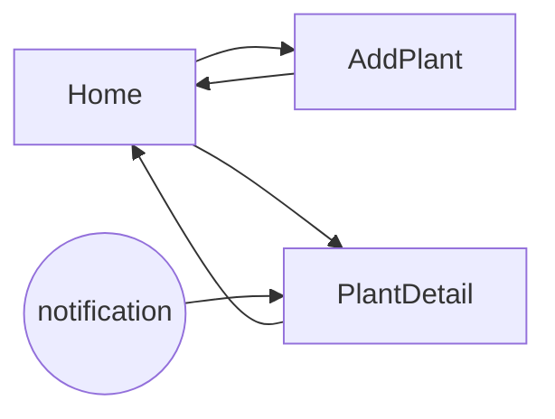

# The `.ugly/` contract

`ugly-app` and `pretty-app` both read and write these files in the project's `.ugly/` folder. Each skill ships its own copy of this file; keep the two identical.

## Keep it out of git

On the first run in a project:

1. Append `.ugly/` to `.git/info/exclude` if it isn't there. Not `.gitignore`: that file is committed and would push this workflow onto everyone who clones the project.
2. Confirm with `git check-ignore -q .ugly/`.
3. If `git ls-files .ugly` lists anything, it was committed before. Ask before running `git rm -r --cached .ugly`.

A fresh clone has no `.ugly/`. `pretty-app` can rebuild it from the code; `ugly-app` starts a new one.

## `blueprint.md`

The beats of the app, in order, from first launch to the end of the value chain. One line per beat, then what supports it:

```markdown
# Blueprint: Sprout

1. **First launch.** User: opens the app. System: creates a local store. Back office: none.
2. **Add a plant.** User: name, optional photo, watering interval. System: saves it, schedules the first reminder.
3. **See what's due.** User: opens home. System: lists plants due today.
4. **Water a plant.** User: taps water. System: sets the next due date, reschedules the reminder.
5. **Come back.** System: a reminder notification opens the plant.
```

No screens and no UI words here. If a beat names a button, it's too detailed.

## `flows.md`

Screens and how they connect, plus what each screen shows and does.

````markdown
# Flows



| Screen | Shows | Actions | Beats |
|---|---|---|---|
| Home | plants due today, all plants | water, add, open plant | 3, 4 |

## Stubs

- Notifications: `ReminderService`, fake schedules in memory. Replace before release.
````

## `ux-log.md`

Open questions about the experience, one entry each. IDs never get reused.

```markdown
## UX-012 · Home · open
Kind: layout
Now: JSON list of plants + "Water first due plant"
Question: group by today / this week?
Ideas: two sections; a calendar strip
Decision:
```

- **Kind:** `flow` (screens, order, data or actions change), `layout`, `feel`, `copy` or `delight`.
- **Status:** `open`, `decided` or `deferred`. Closing an entry fills `Decision:` with what was picked and a one-line why. `deferred` also needs a why.
- `delight` entries stay `open` until hi-fi.

## Tags in code

Where an entry applies to a specific place, the code gets a one-line comment in the stack's comment syntax:

```
// UX-012: group by today / this week?
```

The log holds the detail; the tag only points at it. Closing an entry removes its tags. A tag with no entry, or an open entry whose screen has no tag, gets reported, not silently fixed. Tags are committed with the code, so they must be gone before the app ships: the hi-fi gate requires zero.

## `status.md`

Each screen's fidelity:

```markdown
| Screen | Status | Note |
|---|---|---|
| Home | lowfi | variant B picked |
| PlantDetail | json | flow change, UX-015 |
```

`json` → `lowfi` → `midfi` → `hifi`. A flow change sends a screen back to `json`.
